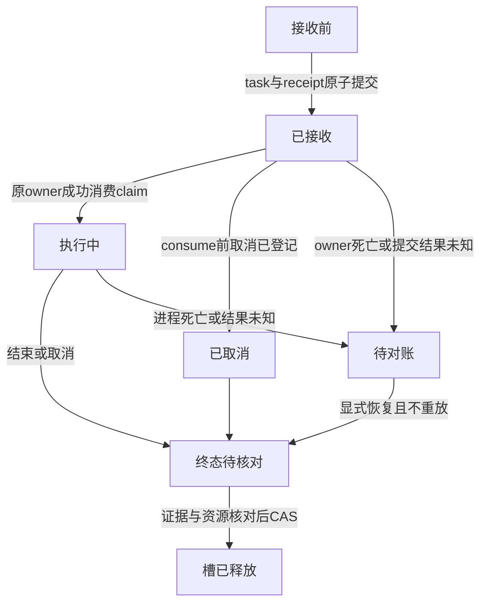

# P1-01 B1：网页修复接收与一次执行权

2026-10-15。Feature P1。状态：详细设计已独立复审通过；B1a/B1b内部实现均已验收done，B2 API尚未实施。父规格为[34](34-p1-01-web-repair.md)，P0-06/UI-08已验收。本文只冻结B1与B2必须遵守的服务契约；审批由B4另行设计。

## 1. 目标与不变量

网页开始操作最终调用已有RepairController，而不是另写修复Agent。先解决“用户点了一次，服务器究竟接收了没有、谁有权执行、重启后怎么办”。

| ID | 不变量 |
|---|---|
| A01 | request_id等于task_id；每次明确新建一个UUID，同请求重查/重提交必须使用原UUID |
| A02 | RepairTask、created事件和接收记录同事务提交；接收失败不留下半个任务 |
| A03 | 首次接收只发一份内存claim；重复POST、GET、重启均不发新claim |
| A04 | claim消费在SQLite短事务中完成；仅消费成功者可进入模型/工具循环 |
| A05 | 任一外部调用先走原持久预算/操作登记；网页层不能重置预算或恢复重放 |
| A06 | cancel_requested只从0变1；收到停止请求不等于停止完成 |
| A07 | 活动槽只有终态、执行身份全部可核对且资源安全时才能释放；未知不能冒充空闲 |
| A08 | HTTP请求断开不销毁已接收任务的owner；进程退出不授权另一个进程续跑 |

图中是接收/运行控制状态，不是向现有RepairTask.phase新增枚举。只对本项目接收与执行权提供幂等边界，不承诺任意外部工具exactly-once。安全边界是本机可信单用户，POSIX锁；不引入队列、租户或新角色。

## 2. 请求、指纹和固定策略

严格请求：`{request_id, case_id, mode}`。UUID沿用Identifier标准格式；case为 `output_mismatch|counter_offset`，mode为 `single_role|three_role`；额外字段拒绝。网页不能传源码、路径、模型、端点或验收规则。

`payload_sha256 = SHA256(canonical({version:1, request_id, case_id, mode}))`。请求指纹只用于判断“相同用户意图”，不包含运行时配置。`policy_sha256`单独冻结策略版本、两案例及其manifest、预算、容器策略、oracle/suite版本。任务已有model_config_sha256与baseline指纹仍是模型/代码来源依据。

固定Budget：total_tokens=2,000,000，output_tokens=8192，model_calls=12，tool_calls=20，candidates=2，timeout_seconds=600。金额未配置仍为未知。600秒从持久接收时的task.started_at起算；网页排队/启动延迟不能重置时钟，开始前已超时则终止且零新模型调用。

先查已有请求，再校验当前模型配置和策略：同参请求在模型断开或策略升级后仍能查询历史。复用旧请求不采用新policy，不重签旧任务；新执行必须新request_id。

## 3. 持久化契约：0008_web_repairs

显式additive迁移新增表 `web_repair_requests`：

| 字段 | 类型/约束 | 意义 |
|---|---|---|
| request_id | TEXT PRIMARY KEY | 与repair_tasks.task_id相同；逻辑关联，不级联删除接收墓碑 |
| payload_sha256 | TEXT NOT NULL | 规范请求摘要 |
| case_id / mode | TEXT NOT NULL +枚举CHECK | 原始安全请求字段 |
| policy_sha256 | TEXT NOT NULL | 首次接收时固定策略摘要 |
| initial_sha256 | TEXT NOT NULL | 初始RepairTask的canonical摘要 |
| claim_sha256 | TEXT NOT NULL | 32随机字节令牌的SHA256，不保存明文 |
| consumed / active / cancel_requested | INTEGER NOT NULL，分别CHECK IN(0,1) | 执行权已消费、槽占用、持久停止标志 |

增加部分唯一索引 `UNIQUE(active) WHERE active=1`，即同状态目录最多一项网页修复。字段内容与摘要格式在store层严格复核，不以SQL列存在等于数据可信。初始任务维持现有schema1、phase=ready、revision=0、零usage；现有只读list/detail schema2和comparison/diff schema1不因本表改变。

不把已消费状态塞入RepairTask.phase：它属于接收账本。消费事务验证当前任务仍等于initial_sha256、revision0且ready，然后CAS consumed 0→1；RepairTask内容不变。重复consume即使任务仍revision0也拒绝。取消在消费前存在时，在同一事务消费claim并用原finish路径持久化cancelled终态；不返回可执行授权。接收后预算期限已到时同理持久化budget_exceeded/DEADLINE_EXCEEDED；时钟倒退等校验异常则保留待对账，不启动模型。

旧库0007→0008只能通过显式CLI迁移。对所有旧表逐行canonical内容、BLOB字节、事件顺序和计数做保真检查。新表有行时降级拒绝；空表才可移除。旧版本程序遇到0008应schema_incompatible，不能猜测兼容。API GET/启动均不迁移主库。

## 4. 组件职责与接口

新增 `web_repairs/{models,fencing,store}` 为B1；B2再加 `service,api,catalog`。产品Agent目录不变。

- `RepairWebFence`：状态目录下专用 `repair-web-owner.lock`，复用现有安全文件/非阻塞flock约定，不删除或替换正在使用的锁文件。
- `WebRepairStore`：基于现有ReproductionStore能力，管理接收/取消/消费/释放。模型预算、T05/T06/T07账本仍由原模块负责。
- `RepairAdmission`：saved、cancel_requested、可选private claim；claim仅原接收方持有，禁止进入JSON/日志/事件。
- `RepairStart`：saved、cancel_requested；只能从成功consume返回，不能从GET构造。
- 私有 `RepairAdmissionClaim`：task_id、initial_sha256、随机token、原owner对象、当次owner nonce。不能序列化/从HTTP反序列化。owner每次acquire产生nonce并记录进程PID；require核对仍持锁、原PID和nonce，旧claim不能跨fork、close/reacquire复活。

store接口：`existing(request)`、`admit(request, initial, policy, owner, task_fence)`、`consume(claim, expected_initial, case_id, mode, policy, task_fence)`、`request_cancel(task_id)`、`receipt(task_id)`、`release_checked(...)`。每个变更接口返回已提交后的强类型结果，不把SQLite异常文本暴露到HTTP。

将原 `RepairStore.create_task()` 内创建任务/created事件抽出为接收Connection的私有 `_create_task`；原CLI方法仍包自己的事务。admit在自己的单一事务调用私有helper，再插入接收行。同样将现有finish_task内部逻辑抽为接收Connection的私有 `_finish_task`，公开CLI包装仍自开事务；消费前取消/超时由consume事务调用该helper，使receipt、task和finished事件共同回滚。禁止helper内部开启嵌套独立事务。

Controller拆为：

1. CLI `run()`：沿用验证、创建、锁和预算路径。
2. 网页 `run_created(claim, saved, fence)`：验证资源与原case/mode/baseline/model_config/policy匹配，消费claim；只有成功后进入公共循环。
3. 私有公共循环：保持原角色权限、T05/T06/T07和预留/结算，不从调用方字典构建执行授权。

run_created不得获取第二把同task锁；调用方lifespan owner已经持有task fence直到执行及回收结束。不得接受历史finished、非初始revision或任意RepairTask重入。CLI调用同task_id仍按原创建冲突拒绝，不能绕过网页claim。

## 5. 接收顺序与竞态

1. 解析严格请求，先用existing查询。找到同参历史返回200，异参409，墓碑410；均无claim。
2. 无历史才尝试repair网页owner非阻塞锁；占用返回429。获取后再次查询existing，处理并发前一次刚提交的请求。
3. 有活动墓碑/旧任务时检查恢复条件；未知返回409 recovery_required，不新建。只读查询不清除活动行。
4. 新建前校验库版本、现有模型配置、固定两案例/manifest、已准备镜像/源码及oracle版本；获取task fence。
5. 准备经过审核的baseline快照；此时仅本地受限文件动作，不运行模型或容器。数据库事务前失败可能留下未被引用的baseline副本；现有repair-recovery并不清理这类快照。本阶段保留孤儿，不自动删除，记录为磁盘遗留限制。以后若增加清理入口，须先证明精确UUID、无引用、inode/摘要绑定；不得泛扫目录删除。
6. admit事务重查请求、task_id冲突、活动唯一性，校验初始任务及case绑定；原子写task+created+receipt，随机claim仅发给首次提交者。
7. API lifespan注册的owner继续持有两把锁；持久提交后方可202。HTTP协程使用shield等待接收结果，客户端断开不取消owner。
8. consume原子核对owner nonce、claim摘要、policy、case/mode、initial SHA、active=1、consumed=0、零调用初态。取消/超时先终止；否则进入原循环。

拒绝重复请求的线性化点为admit事务；执行权的线性化点为consume的CAS。事务commit结果未知时不得沿用旧cursor执行；重新只读确认，不能获取新claim。任务/receipt缺失或矛盾属于store_corrupt或request_gone，拒绝执行。

## 6. 取消、停止与恢复

取消接口仅接受既有web receipt对应task；CLI任务不能通过网页取消。持久标志写入成功返回202，重复取消不增加revision或创建新任务；终态取消返回200与当前结果。task不存在404，墓碑410。停止按钮显示“正在停止”直到实际终态。

B2 owner监视取消标志，轮询间隔上限250ms。执行循环在每次外部调用前检查取消，并用原预算reserve/send边界处理竞争：调用已发送则按实际/未知结算，不能保证迟到的取消导致零调用。取消已在consume前持久化的任务必须零模型零容器。不得为取消中断正在进行的短事务一半。

shutdown先停止接收，再请求取消owner；等待原有有界执行与回收。无法确认结算或资源回收则保留active与未知状态。SIGSTOP时锁仍占用；SIGKILL后锁释放但active仍在，新worker不得启动旧任务。

恢复使用现有repair-recovery的精确身份清单与inspect/apply语义。补充内部“已持task fence”的恢复入口，公共CLI包装仍持锁；网页释放按 `web owner → task fence → 短事务` 顺序，禁止在持task锁时反向拿web锁。

`release_checked`不是只看task.phase，也不是单次inspect返回absent就放行。释放要求如下：

1. task已终态，receipt/任务/请求/计划/事件全部通过既有严格审计；没有pending请求或未决T06发布。
2. 正常finished T05/T07记录必须有合法报告；“finished却缺报告”是损坏，拒绝释放。合法中断可为outcome_unknown且report=None，但须有对应reconciled事件及完整计划/attempt身份；不得补造测试报告。
3. 对每个实际或可能执行的create身份，要有**创建操作已终结的正向依据**：可信执行证据明确create未发送；或已知create已完成且其精确容器身份随后移除得到确认；或现有执行层提供可验证的quiescence证明。未知create、docker客户端可能仍在运行、daemon可能迟到完成时，即便当前inspect为absent也保持recovery_required。
4. 缺报告不自动等于损坏，也不自动等于安全。合法中断缺报告在资源正向依据齐备后可以释放；若现有计划/账本无法区分“未发送create”和“create结果未知”，则保守不释放，不推测后续T07 slot尚未执行。`repair-recovery --apply`返回成功本身不能替代此证明。固定sleep、多次absent和PID消失均不能证明daemon端没有在途创建。
5. 在web/task锁持续持有期间，事务外核对全部身份和资源，再短事务核对task revision/SHA、receipt active/consumed及证据绑定，CAS active=0。任何冲突保留active。不得通过删接收行、换request_id或重启API跳过。

恢复能力因此有明确限制：本阶段可释放已确认终结并回收的执行；创建是否已终结无法证明的故障会继续阻塞该修复槽，页面说明待恢复，不能承诺所有SIGKILL都能由当前CLI解除。补充正向执行证明机制属于B1b必要验收评估；没有依据时采用保守路径，不新增任意“强制解锁”。历史模型用量未知仍保留原预留和未知结果；对账不重写为通过。

GET只观察，不启动、消费claim、清槽或回收。人工执行恢复后，下一次明确提交可核对并释放安全旧槽；对账失败应先恢复，不能绕开旧槽。

## 7. 并发资源上限

以下是B2必须验证的组合目标，不是本次设计已证明的现有系统全局保证。B2须一并审查复现/分析槽在未知create、reconcile后释放时的正向终结依据，必要时分批修复对应释放判断；只给新repair槽加保护不足以证明组合上限。未通过组合故障测试，不对外宣称硬性总上限。

限定同一个AWB_STATE_DIR的网页请求，沿用各类独立槽：复现1、分析1、修复1，最多3个已接收活动任务。分析/修复各自串行模型与工具；T07四格顺序执行，不并发起4个容器。

| 资源 | 网页组合上限 | 边界 |
|---|---|---|
| 已启动且本地仍等待的模型HTTP请求 | 2 | 分析1+修复1；远端在断线后是否继续运算不可知，不声明网关全局并发上限 |
| 受控执行容器 | 3 | 每类最多1；遇创建/清理未知则该槽不启动下一个执行 |
| 容器CPU/内存/PID配额之和 | 1.5 CPU / 384 MiB / 96 PIDs | 单容器0.5/128MiB/32；不包含API、浏览器、Docker daemon或模型服务器 |
| 活跃网页模型预算之和 | 4,000,000 tokens | 分析与修复各2M；不是账户或每天总额度 |

手工CLI及其他状态目录不计入网页槽，因此以上不是整台主机的全局上限。页面显示“本工作区网页任务”范围；本轮不引入全局调度器。停止/未知实验必须证明不穿越自己的槽上限。历史未知模型预留保持不变，不能把“本地已不等待”解释为无费用或远端已停止。

## 8. HTTP结果契约（B2沿用）

新目录 `GET /api/repair-runs/catalog`，只读接收查询 `GET /api/repair-runs/{request_id}`，开始 `POST /api/repair-runs`，取消 `POST /api/repair-runs/{task_id}/cancel`。最终diff等继续用 `/api/repairs`。

| HTTP | 稳定错误/响应 | 含义 |
|---|---|---|
| 202 | 首次接受/取消已登记 | 持久提交已完成；不是执行成功 |
| 200 | reused=true或当前receipt | 只返回原任务，不交付claim |
| 400 | invalid_request | JSON、额外字段、UUID、枚举失败 |
| 403 | forbidden_origin / forbidden_host | 沿用现有本地访问边界 |
| 404 | web_repair_not_found | 未发现该接收记录；单次查询不证明从未发起外部请求 |
| 409 | request_conflict / recovery_required / version_mismatch | 原请求冲突、旧槽待处理或执行材料不一致 |
| 410 | request_gone | 墓碑仍在，原任务已清理；绝不重建 |
| 429 | repair_busy / repair_reads_busy | 当前执行槽或只读槽忙碌；写请求不自动重发 |
| 503 | model_not_configured / image_unavailable / schema_incompatible / store_unavailable / service_stopping | 前置不可用；不得泄露原始异常、路径、端点或密钥 |

接收/取消/目录响应schema_version=1、no-store。receipt安全返回request/task ID、case/mode、cancel_requested、active及原RepairTask当前摘要；不暴露claim/policy内部路径。严格Host/Origin、JSON 4KiB、读体5秒边界复用已有API验证器。读取策略变更不能修改原task历史状态。

浏览器POST前保存pending。未知提交状态只GET查询；用户明确“重新提交同一请求”才POST（可能首次执行）。404允许继续查询或同ID明确提交，不默认清除pending/新建任务。429读可有界退避；不得把自动写重试加入通用fetch封装。

## 9. B1测试冻结清单

所有测试使用临时SQLite、确定性时钟/adapter和多进程锁；不调用真实模型、不迁移用户主库。下面断言为实施验收契约，不是已经通过的结果。

| ID | 测试 | 必须断言 |
|---|---|---|
| B1-01 | admit插入各阶段注入失败 | task/event/receipt全有或全无；取消/超时的consumed更新、finished事件和task任一步失败共同回滚，零模型/工具 |
| B1-02 | 同参重复、异参、CLI同ID、缺task墓碑 | 同参同任务无claim；409/410；旧记录字节不变 |
| B1-03 | 两进程相同/不同ID并发admit | 一个有效claim/一个active；唯一索引实际SQLite生效 |
| B1-04 | 伪造token、错owner/目录/nonce、close后reacquire | 全部拒绝；未消费、零预算/调用变化 |
| B1-05 | 重复consume、非初始revision、错误case/mode/policy/SHA | 拒绝；成功consume只有一次；即使task仍ready也不可再消费 |
| B1-06 | 取消先于consume、消费与取消交错 | 前者零调用cancelled；后者已发送按原账本结算，不伪零费用 |
| B1-07 | admit后进程死亡、SIGSTOP | 新owner不能重放；SIGSTOP锁不能被夺走；active不丢 |
| B1-08 | 接收延迟超过600秒、时钟倒退 | 零新调用/明确错误；不重设deadline |
| B1-09 | 迁移0007→0008及回滚 | 全部旧表字节/顺序不变；非空新表拒绝降级；未迁移API不自建表 |
| B1-10 | 新run_created与旧CLI共享循环 | 四种case/mode组合、T06/T07/预算/停止老回归仍过；旧已结束任务不可重入 |
| B1-11 | 释放槽：损坏缺报告/错资源/未知创建或清理/未决T06 | 拒绝释放；不删除别的容器；检查后版本变动CAS失败 |
| B1-12 | 人工recovery后安全释放 | 合法中断report=None+reconciled可继续核对；正向证明齐备才释放，原未知历史与预留保持；仅CLI apply成功不充分 |
| B1-13 | 事件/摘要/receipt列被篡改 | 严格读取拒绝，raw异常和claim不入日志/DTO |
| B1-14 | 父进程死亡后create迟到，在inspect absent后出现 | 初次absent不得释放槽，不启动下一个修复容器；正向终结/回收证据到位后才可释放 |

B2补真实多worker/HTTP断连/shutdown与资源组合；B3补页面pending、刷新、键盘/浅深/390与1440；B5补既有真实模型+真实Docker与网页。不能把B1 fake测试计为修复效果。

## 10. 实施拆分与完成条件

B1a：迁移、请求/claim契约、owner与原子admit/consume/取消，独立review。B1b：controller创建/执行拆分、取消/时钟、带正向终结依据的恢复安全释放（依据不足则阻塞）与旧CLI回归，独立review。每批控制约2000行以内，超出继续拆分。不得以未实现API为由省略核心竞态反例。

B1设计通过只允许上述内部实现；在B2/B3实链路门禁之前保持网页修复只读和现有能力标记，不提前增加可点击开始按钮。设计评审记录附在现有[预审报告](reviews/P1-01-web-repair-design-review.md)。台账P1-01保持in_progress，B1实现完成需新的测试与代码复审证据。

设计冻结记录：2026-10-15首轮1项P1、2项P2及1项P3已修订并复审通过，见现有设计报告B1追加节。该结论仅允许B1a内部实现，尚无新代码验收结果。

### B1a实现评审补充

2026-10-15。一次性执行权实现增加SQLite不可变列、consumed/cancel_requested单调、active不复活与墓碑不删除触发器，事务入口核对触发器定义。web/task fence增加进程内生命周期guard，避免等待事务期间close/reacquire使已核对claim过期。私有claim采用不可变非dataclass对象，拒绝框架JSON/dataclass/pickle展开。原契约范围不变，实际验收及后续未完成条目见[36](36-p1-01-b1a-delivery.md)。

### B1b 实施

执行入口共用原 CLI 循环，取消、截止时间与正向资源证据释放已实施并通过验收；具体边界和测试记录见[37](37-p1-01-b1b-delivery.md)。API/页面写入口仍属后续批次。
